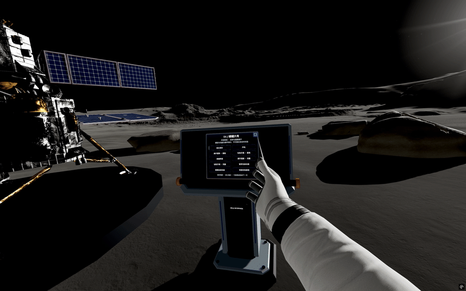

# CZCIT Arm UI

**BeiWuCN · MIT**

在 VR 中把自己的世界空间 Canvas 停靠到左腕。翻腕显示，用右手拖出面板，靠近左腕松手即可归位。可搭配默认控制器或自定义手臂模型，独立于 GlassUI。

- [下载 Unity 包](https://github.com/BeiWuCN/CZCIT.ArmUI/releases/tag/26.11.17)
- [详细使用教程](Assets/CZCIT%20Arm%20UI/README.md)
- [MIT 许可](LICENSE)
## 效果演示

